# vivo PC Suite (Office Kit) for Linux

Run **vivo PC Suite / vivo Office Kit** natively on Linux, with an English UI and no Wine.

The kit takes **your own Windows install** of vivo PC Suite and rebuilds it into a native Linux app. vivo's
Windows-only helper programs are replaced with Linux implementations: a FUSE phone drive, photo backup over
adb, a call-handoff window, scrcpy mirroring and more. It's aimed at vivo phones (including China models)
that don't do normal USB/MTP file transfer.

The app opens in an **iTunes-style window**: a music library and player, iTunes-style music sync to the phone,
vivo's own Office Kit pages, and Google services in place of vivo's cloud.

<p align="center">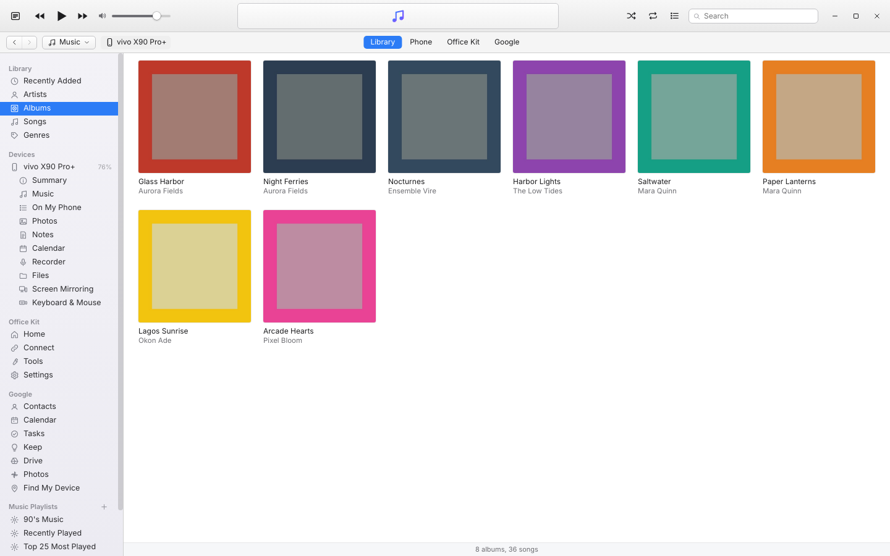</p>

| | |
|---|---|
| 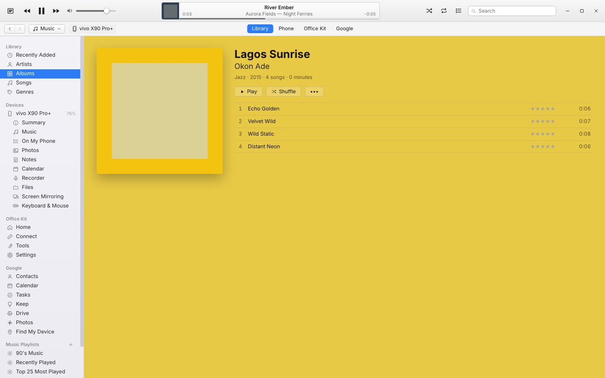 | 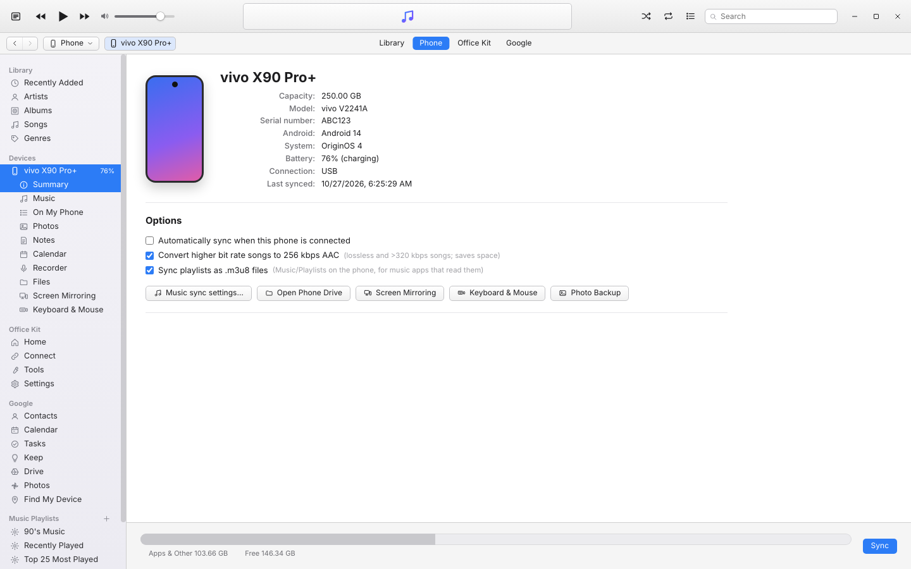 |
| **Album view and player** | **Phone summary and sync options** |
| 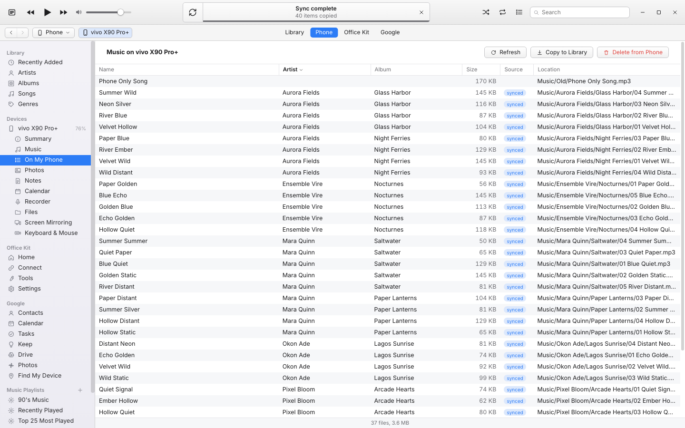 | 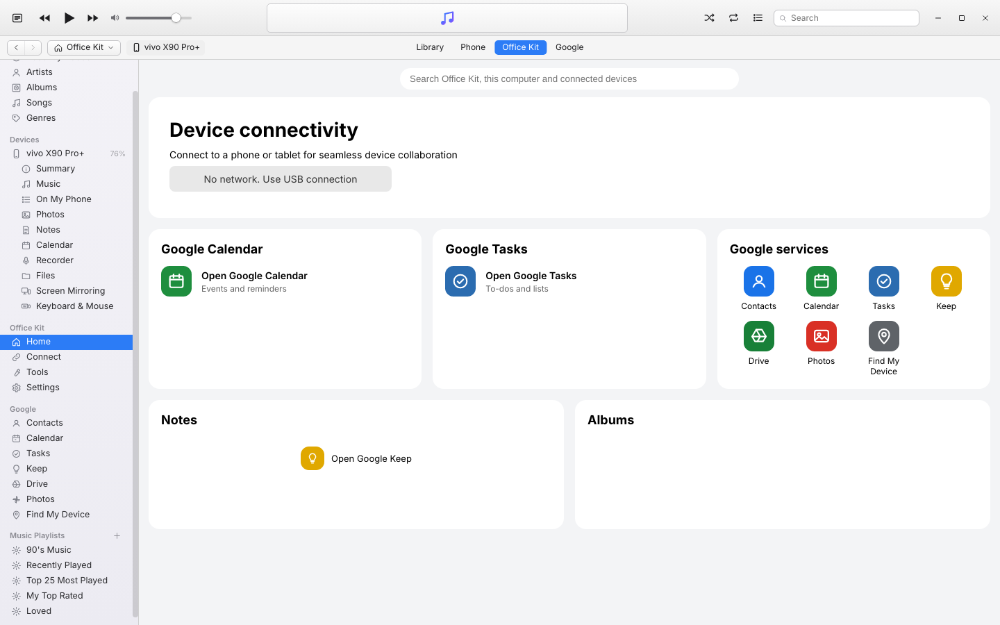 |
| **Music on the phone** | **Office Kit home, with Google instead of vivo cloud** |

vivo's own pages (shown with `PCSUITE_CLASSIC_UI=1`, vivo's original window):

<p align="center">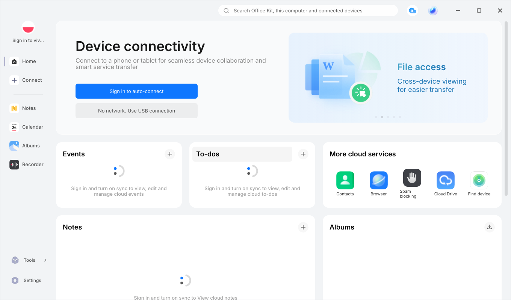</p>

| | |
|---|---|
| 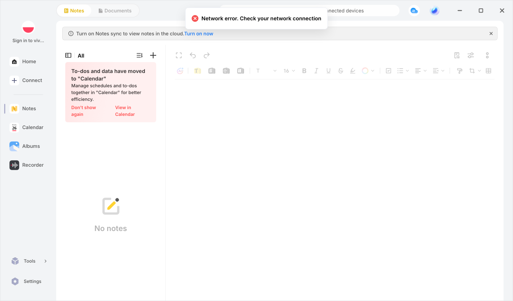 | 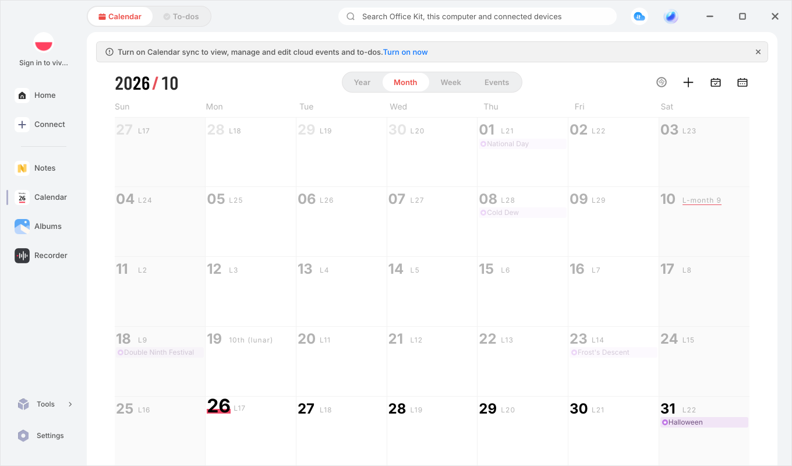 |
| **Notes** | **Calendar** |
| 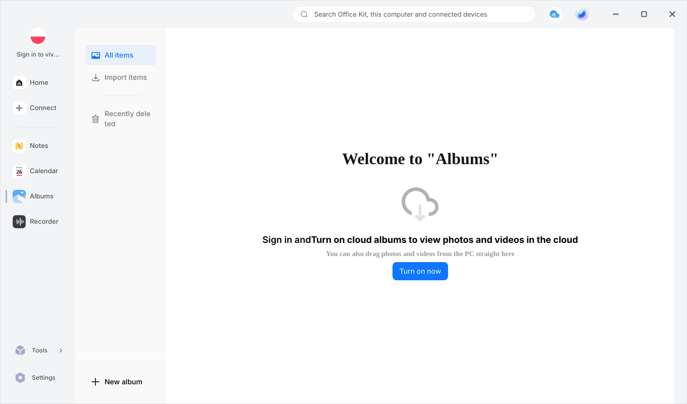 | 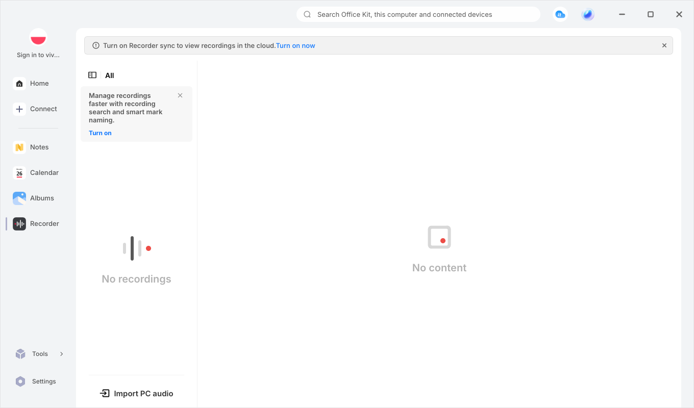 |
| **Albums** | **Recorder** |
| 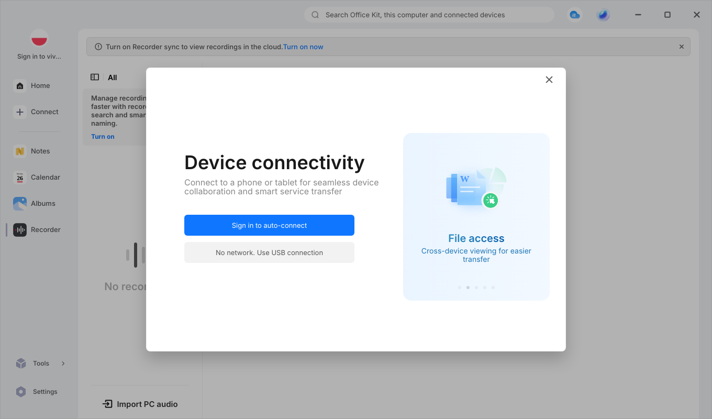 | 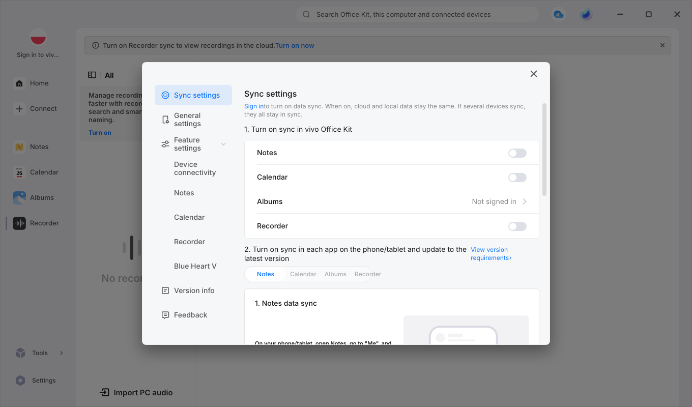 |
| **Connect a phone** | **Settings** |

<p align="center">
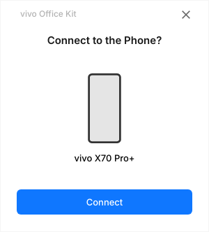&nbsp;&nbsp;
&nbsp;&nbsp;

</p>
<p align="center"><sub>USB connection prompt · incoming call on the PC · call in progress</sub></p>

> The screenshots show the **China edition** (the default) running on Linux in English, taken without a
> phone signed in. Not affiliated with or endorsed by vivo. You need your own copy of vivo PC Suite; this
> repo doesn't distribute any vivo software.

## How it works

The Windows app is an Electron program, so its interface and logic are JavaScript. `build.sh` runs vivo's own
code on the **Linux build of the same Electron version (22.0.0)** and patches out the Windows-only parts. Each
native Windows helper (`.exe`/`.dll`) was reverse-engineered and replaced with a Linux implementation (see
the table below). Phone communication goes through `adb`, the same tool PC Suite bundles as `adb.exe`.

Tested with vivo PC Suite **7.0.6**.

## Install (CachyOS / Arch)

```bash
sudo pacman -S --needed android-tools android-udev scrcpy ffmpeg fuse3 libnotify python git
git clone https://github.com/Brenyd/Vivo-PC-Suite-Linux.git
cd Vivo-PC-Suite-Linux
./build.sh "/path/to/your/pcsuite"   # the installed Windows folder, or a .zip of it
```

Where to get the Windows folder: install vivo PC Suite with Proton or Wine once, just to unpack it, then point
`build.sh` at the `pcsuite` folder. With Steam/Proton, for example:

```bash
./build.sh "$HOME/.steam/steam/steamapps/compatdata/<appid>/pfx/drive_c/Program Files (x86)/pcsuite"
```

The build downloads exactly two files, each pinned by SHA-256: Electron 22.0.0 for Linux and the sqlite3
native module (both from GitHub). It installs to `~/.local/share/vivo-pcsuite` and adds **vivo Office Kit** to
your app menu and `vivo-pcsuite` to `~/.local/bin`. Re-run it any time: it replaces the previous build atomically.

Options:

- `--edition china|global`. The default is `china`: vivo's domestic build, for China-model phones and China vivo
  accounts, with the UI in English. `global` is the international build.
- `--prefix DIR`
- `--no-desktop`

## The iTunes-style window

The window has iTunes' toolbar (transport controls, volume, the LCD showing what's playing or the sync
progress, shuffle, repeat, Up Next and search) and a source list with four groups. The tabs at the top jump
between them.

**Library (music).** Your music folder (`~/Music` by default; add more under *Preferences*) is scanned
automatically: MP3, AAC/M4A, ALAC, FLAC, Ogg Vorbis, Opus, WAV and more, with tags and album artwork (embedded
or `cover.jpg`/`folder.jpg`).

- Views: Albums (with a colored album page), Artists, Songs (sortable columns), Genres and Recently Added.
- Playback: shuffle, repeat one/all, Up Next (Play Next / Add to Up Next) and a 10-band equalizer with
  iTunes' presets. Ratings, Love, and play and skip counts. Desktop media keys and KDE's media controls work
  through MPRIS.
- Playlists: create, rename, drag songs in, and reorder. Smart Playlists have rules (match all/any, a limit,
  live updating). 90's Music, Recently Played, Top 25 Most Played, My Top Rated and Loved are
  set up for you.
- Get Info: edit tags for one or many songs, change the artwork, and write the tags into the files (needs ffmpeg).
- Add music with *File → Add Folder / Add Files*, or drag it onto the window.

**Phone (devices).** A connected phone appears under *Devices*, the way an iPod did:

- *Summary*: model, capacity, Android and OriginOS version, battery, and the sync options.
- *Music*: **Sync Music** with the entire library, or selected playlists, artists, albums and genres.
- *On My Phone*: all music on the phone, with play, copy to the library, and delete.
- Screen mirroring, keyboard & mouse and the phone drive, one click each.

How sync works:

- Songs go to `Music/<Artist>/<Album>/` on the phone, and playlists become `.m3u8` files in `Music/Playlists`.
- Sync is incremental and only copies what changed. A cancelled sync resumes where it stopped.
- Optionally, lossless and very high bit-rate songs are converted to 256 kbps AAC, and the phone syncs
  automatically when it's plugged in.
- **Sync only ever removes songs it put on the phone itself** (it keeps a list in
  `Music/.vivo-officekit-sync.json`). Music you copied there another way is left alone.

**Office Kit.** vivo's own pages: Home, Connect, Notes, Calendar, Albums, Recorder, Tools and Settings.
vivo's window is docked into the content area, so it behaves exactly as before.

**Google.** Google replaces vivo's cloud, which needs a vivo account and doesn't work outside the vivo
ecosystem. The pages open inside the window with one Google sign-in that's remembered (*Open in Browser* is
always there as a fallback):

| vivo cloud | Google |
|---|---|
| vivo account sign-in | Google account |
| Contacts | Google Contacts |
| Events (calendar) | Google Calendar |
| To-dos | Google Tasks |
| Notes sync | Google Keep |
| Albums backup | Google Photos |
| Cloud Drive | Google Drive |
| Find device | Find My Device |
| Browser sync, spam blocking, "Sign in to auto-connect" | hidden (no Google web equivalent; USB connection still works) |

China-model phones usually ship without Google Play services. The Google pages work on the PC either way,
but for the phone itself to sync contacts and calendar with Google, or show up in Find My Device, it needs
Google services installed.

## Phone setup (one time)

1. **Settings → About phone → Software version**: tap it 7 times to unlock Developer options.
2. **Developer options → USB debugging**: on.
3. Plug in the phone, unlock it, and accept **Allow USB debugging** (tick *Always allow*).
4. In the app, click **No network. Use USB connection** (or **Connect**), then tap **Agree** if the phone asks.

## Features and what replaces the Windows parts

| Feature | Windows | Linux |
|---|---|---|
| UI language | Chinese in the China edition | English. vivo's locale keys are merged, about 4,500 hard-coded strings are translated at build time, and a live translation layer handles the rest. Set `PCSUITE_LANG=zh_CN` for Chinese |
| Phone connection | `adb.exe` | your system `adb` (`PCSUITE_ADB=/path` to override) |
| **Phone as a drive** | Dokan driver (`vdfs.exe`) | FUSE file system over adb. Mounts automatically at `~/vivo Phone` while the phone is connected (read, write, rename, delete) |
| Drag phone files to the desktop | Windows virtual-file drag | drags straight from the mounted phone drive |
| **Photo & video backup** | `vivoBackup.exe` | `backup-worker.js`: copies new photos/videos from DCIM, Pictures and Movies into `<backup folder>/<phone>/<album>/`. Incremental, keeps file dates, drives the app's progress card, auto-backup and pause |
| **Answer calls on the PC** | `phoneCall.exe` | call card with Answer, Decline, Hang up and Mute, driven over adb. Closes when the call ends. **Listen on PC** plays the call audio through scrcpy (Android 11+) |
| Screen mirroring / PC mode | `PCMode.exe`, `vivoScreen.exe` | **scrcpy**, opened only when you click Screen mirroring |
| Keyboard & mouse sharing | `vivoRelay.exe` | scrcpy with UHID keyboard/mouse, so the PC's keyboard and mouse control the phone. Opened only when you click it. vivo starts its relay by itself at launch and restarts it whenever it exits, so on Linux it gets a stand-in process instead of a window |
| Phone camera as webcam | `vCamera.exe` | scrcpy camera → v4l2loopback virtual webcam (setup below) |
| Local databases (notes, calendar, albums, recorder, settings) | created by `vivoSyncService.exe` | `db-init.js` creates the same SQLite schemas and migrations (recovered from the service binary) |
| Notifications | `pc_toast.exe` | `notify-send` |
| Open / reveal files, disk space, OS info | `dragfile.node` | `xdg-open`, `gio`, FileManager1 D-Bus (Dolphin highlights the file), `df` |
| PC file search | Everything SDK | `plocate`/`locate` when installed, otherwise `find` in your home folder |
| Registry reads (region, user) | `regedit` + `cscript` | answered from the Linux environment |
| Tray icon / window | `.ico`, Windows title bar | PNG icon, vivo's own title bar |
| Auto-update / hot patches | downloads Windows files | turned off. Update by installing the new Windows version and re-running `build.sh` |

### Phone camera as a webcam (optional)

```bash
sudo pacman -S v4l2loopback-dkms
sudo modprobe v4l2loopback card_label="vivo Phone Camera" exclusive_caps=1
# make it permanent:
echo v4l2loopback | sudo tee /etc/modules-load.d/v4l2loopback.conf
echo 'options v4l2loopback card_label="vivo Phone Camera" exclusive_caps=1' | sudo tee /etc/modprobe.d/v4l2loopback.conf
```

### Not available on Linux

- **vivo-account cloud sync** of Notes, Calendar, Albums and Recorder (`vivoSyncService.exe`). This is vivo's
  proprietary, request-signed sync engine. Re-implementing it without vivo's server specification could corrupt or
  delete cloud data, so it is left out. Everything on the phone over USB still works, and the cloud data stays
  available on the phone and at vivo's web cloud.
- Call audio **from the PC microphone** to the phone. Audio plays on the PC (Listen on PC), but you talk through
  the phone.
- Extended screen (phone as a second monitor) and Remote PC. Both need vivo's Windows display/remote drivers.
- The voice-recorder audio engine (`vaudio_kernel.dll`). vivo already ships no-op stubs for this on macOS.

## Settings (environment variables)

| Variable | Effect |
|---|---|
| `PCSUITE_LANG` | UI language (default `en_US`) |
| `PCSUITE_COUNTRY` | region code (China edition default: `CN`) |
| `PCSUITE_ADB` | adb binary |
| `PCSUITE_NO_DRIVE=1` | don't mount the phone drive |
| `PCSUITE_MOUNT_DIR` | where to mount it (default `~/vivo Phone`) |
| `PCSUITE_BACKUP_DIRS` | phone folders to back up (default `/sdcard/DCIM:/sdcard/Pictures:/sdcard/Movies`) |
| `PCSUITE_SCRCPY_ARGS` | extra scrcpy options for mirroring |
| `PCSUITE_NO_SANDBOX=1` | run without the Chromium sandbox |
| `PCSUITE_REQUIRE_PHONE_UPDATE=1` | enforce vivo's minimum phone-app version (off by default, see Troubleshooting) |
| `PCSUITE_CLASSIC_UI=1` | vivo's original window instead of the iTunes-style one (no music library) |
| `PCSUITE_SHOW_CLOUD=1` | keep vivo's own cloud services and sign-in instead of the Google replacements |
| `PCSUITE_WAYLAND=1` | don't force X11 (XWayland). The docked Office Kit pages need X11 window positioning |
| `PCSUITE_DEBUG=1` | verbose log |

## Troubleshooting

- **Phone shows as "unauthorized"**: unlock it and accept the USB-debugging prompt. Run `adb devices` to check.
- **"This device model cannot connect"**: the phone's system has no `com.vivo.pcsuite` service. Check with
  `adb shell pm path com.vivo.pcsuite`.
- **"Update vivo Office Kit on the phone"**: the phone half of Office Kit is a vivo system app that only updates
  through the phone's system updates, and many China phones never get the version Windows PC Suite 7.0.6 requires.
  The Linux build skips that version check, so older phone versions connect anyway. If one feature misbehaves
  with an old phone version, `PCSUITE_REQUIRE_PHONE_UPDATE=1` turns the check back on.
- **Phone drive doesn't appear**: install `fuse3`, and make sure `~/vivo Phone` is empty.
- **Mirroring or keyboard & mouse windows open on their own**: fixed. They only open when you click them now. If
  a click in vivo's own page doesn't open one, use the buttons under *Devices* in the source list.
  `linux.log` shows each launch, and whether it was "requested by the user" or a vivo background start.
- **Office Kit pages show up outside the window**: the docking needs X11. Don't set `PCSUITE_WAYLAND`, or use
  `PCSUITE_CLASSIC_UI=1`.
- **Google says "This browser or app may not be secure"**: Google sometimes blocks sign-in inside apps. Use
  *Open in Browser*, or try again later.
- **Music library**: the library is stored in `~/.config/pcsuite/music/` (`library.json` and the artwork). Deleting it
  rebuilds it from your music folders. Ratings, play counts and playlists are lost when you do that.
- **Blank window or sandbox error**: run `PCSUITE_NO_SANDBOX=1 vivo-pcsuite`.
- Logs are in `~/.config/pcsuite/log/`:
  - `linux.log`: this port, including every Windows program the app tried to start and what replaced it.
  - `backup_log/backup-linux.log`: photo backup.
  - vivo's own logs.

## Project layout

- `port/patches.js`: 22 small, documented patches to vivo's bundles. `apply.js` fails loudly if a future
  PC Suite version no longer matches one.
- `port/linux-boot.js`: entry point. It fills in Windows-only Electron APIs, maps native modules to
  `port/linux/*.js`, creates the databases, and starts the phone drive and the translation layer. Then it loads
  vivo's `main.js`.
- `port/linux/exe-dispatch.js`: intercepts every launch of a vivo `.exe` and starts the Linux replacement.
- `port/linux/`: the replacements (`backup-worker.js`, `phone-call.js`, `phone-drive.js` + `vivo-phonefs.py`,
  `dragfile-linux.js`, `filesearch-linux.js`, `regedit-linux.js`, `db-init.js`, `dom-i18n.js`).
- `port/itunes/`: the iTunes-style window. `main.js` creates the window and docks vivo's,
  `library.js`/`tags.js` hold the music library and the tag reader, `device.js` does phone info and music
  sync over adb, and `ui/` is the interface.
- `port/linux/google-services.js` replaces vivo's cloud cards with Google ones. `user-intent.js` +
  `exe-dispatch.js` make sure phone windows only open on a click.
- `port/i18n/`: the English pack and its patcher. It only touches display text, and skips any string the code
  also compares against.

This repo contains no vivo program code. vivo's app is taken from your own installed copy at build time. The
repo only includes translation tables for the app's interface text and the database schema needed to
recreate its local databases.
